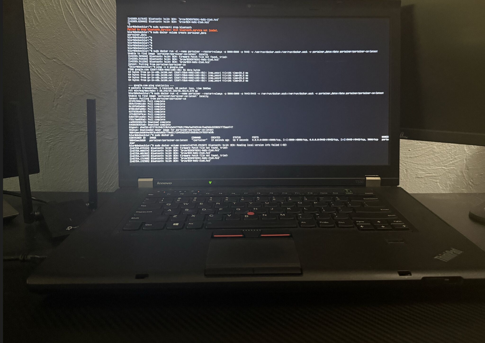
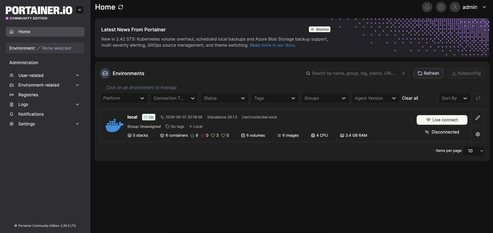
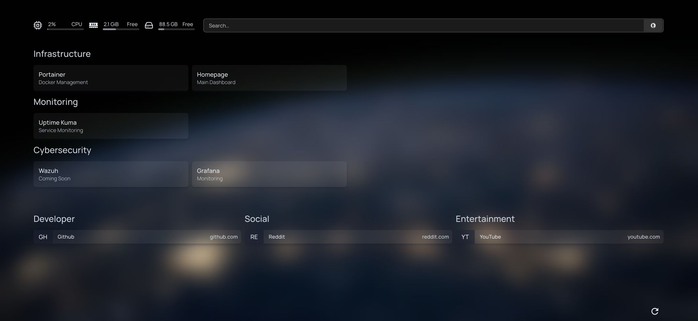
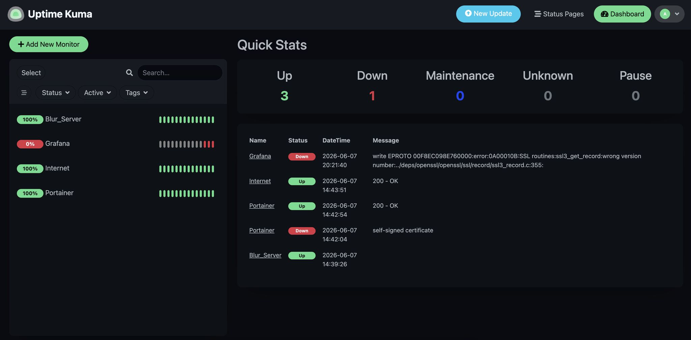
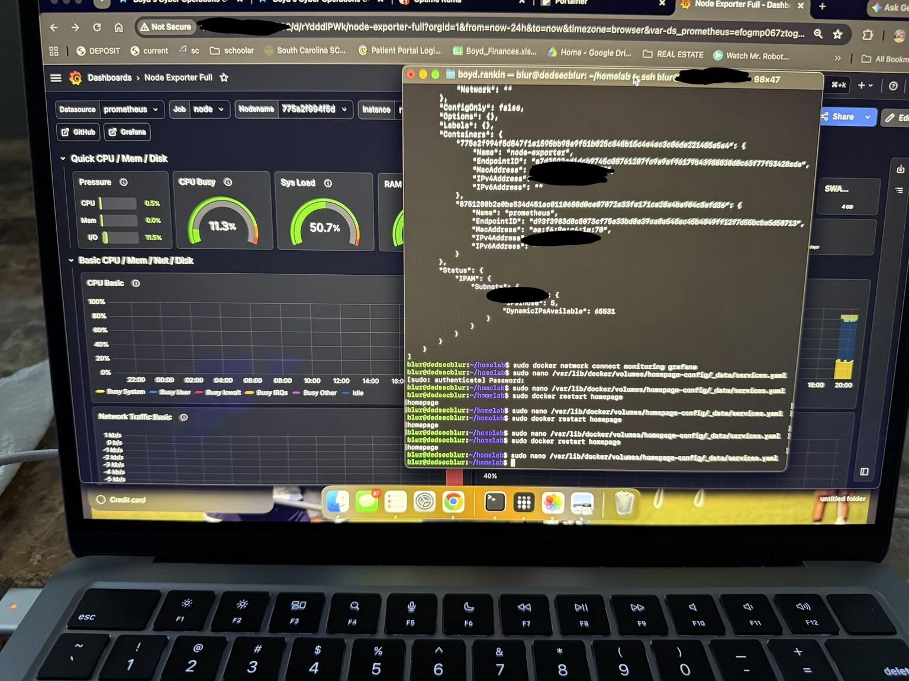

# Cybersecurity Homelab

## Overview

This repository documents my personal homelab, which I built to gain hands-on experience with Linux, networking, system administration, Docker, and cybersecurity-related technologies.

I use my homelab to experiment with different services, learn how systems work, practice troubleshooting, and develop technical skills outside of the classroom. It gives me an environment where I can build, configure, manage, and explore technology through practical experience.

My goal is to continue expanding my homelab while documenting what I build, the technologies I use, problems I encounter, and what I learn along the way.

---

## Technologies Used

| Technology | Purpose |
|---|---|
| Ubuntu Server | Linux server operating system |
| Docker | Containerization and application deployment |
| Portainer | Docker container management |
| Tailscale | Secure remote connectivity |
| Uptime Kuma | Service monitoring and uptime tracking |
| Homepage | Homelab dashboard |
| Prometheus | Monitoring and metrics collection |
| Grafana | Metrics visualization and dashboards |

---

## Homelab Services

### Ubuntu Server
Used as the foundation of my homelab environment. Working with Ubuntu Server has helped me develop Linux command-line skills, system administration knowledge, and experience managing a server environment.

### Docker
Used to deploy and manage containerized applications and services. Docker has helped me understand containerization and how applications can be deployed and managed independently.

### Portainer
Used to manage Docker containers through a graphical interface, making it easier to view, manage, and monitor containerized services.

### Tailscale
Used for remote connectivity to my homelab, allowing me to access my environment remotely.

### Uptime Kuma
Used to monitor services and check their availability and uptime.

### Homepage
Used as a centralized dashboard to organize and access homelab services.

### Prometheus
Used for monitoring and collecting metrics within my homelab environment.

### Grafana
Used to visualize monitoring data and create dashboards to better understand system and service performance.

---

## Screenshots

Screenshots of my homelab environment, services, dashboards, and configurations.

### Homelab Overview

### Docker / Portainer

### Homepage Dashboard

### Uptime Kuma

### Prometheus / Grafana

---

## Skills Developed

Through building and managing my homelab, I have been developing practical skills in:

- Linux system administration
- Command-line usage
- Server management
- Docker and containerization
- Deploying and managing services
- Networking fundamentals
- Remote connectivity
- Monitoring and metrics
- Troubleshooting technical problems
- Learning new technologies independently

---

## Challenges and Troubleshooting

Building a homelab involves learning how different technologies work together and troubleshooting problems along the way.

Through hands-on experimentation, I have gained experience working through configuration issues, learning unfamiliar tools, understanding how services interact, and finding solutions through research and testing.

Rather than only following instructions, I am working toward understanding why systems work the way they do and how to troubleshoot them when something goes wrong.

---

## What I Learned

My homelab has helped me move beyond learning technology in a classroom environment and begin applying concepts through hands-on experimentation.

I have gained experience working with Linux servers, deploying Docker containers, managing services, monitoring systems, and accessing my environment remotely.

It has also reinforced the importance of troubleshooting, patience, documentation, and continuous learning in IT and cybersecurity.

---

## Future Goals

I plan to continue expanding and improving my homelab by:

- Exploring additional Linux and server administration concepts
- Expanding my Docker experience
- Learning more about networking
- Improving system and service monitoring
- Exploring cybersecurity tools and technologies
- Building additional projects
- Documenting new services, configurations, and lessons learned

This homelab is an ongoing project and will continue to evolve as I develop my technical skills and work toward a career in cybersecurity.

---

## About Me

I am a cybersecurity student interested in Linux, networking, system administration, and hands-on technology. My goal is to continue developing my technical skills through coursework, internships, personal projects, certifications, and practical experimentation.

I am particularly interested in the hands-on side of cybersecurity, including building, configuring, troubleshooting, and securing systems.

This repository serves as a documentation of my learning journey and the projects I build along the way.
